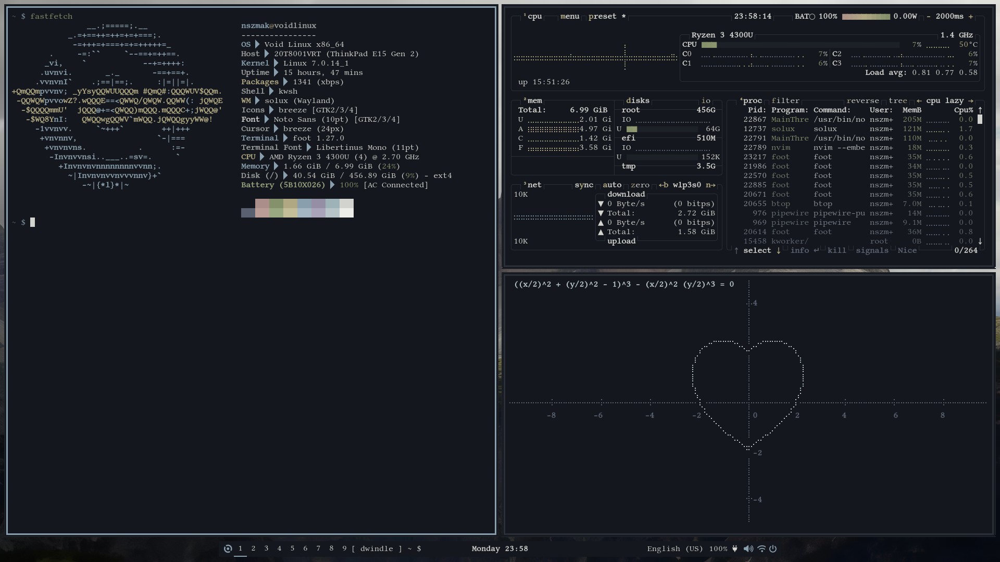

# solux-dotfiles

Personal dotfiles for a minimal, dark, muted-palette Wayland desktop built around the **Solux** compositor. Everything shares one color palette, **Tre Cime**, so the terminal, bar, launcher, browser, editor and GTK apps look like one system.

<p align="center">
  
</p>

## What's inside

| Folder | Program | Purpose |
| --- | --- | --- |
| [`solux`](solux) | Solux | Wayland compositor, configured in Python |
| [`waybar`](waybar) | [Waybar](https://github.com/Alexays/Waybar) | Status bar |
| [`foot`](foot) | [foot](https://codeberg.org/dnkl/foot) | Terminal emulator |
| [`kwsh`](kwsh) | kwsh | Shell, configured in Python |
| [`rofi`](rofi) | [rofi](https://github.com/davatorium/rofi) | Application launcher |
| [`nvim`](nvim) | [Neovim](https://neovim.io/) | Editor, with plugins via vim-plug |
| [`qutebrowser`](qutebrowser) | [qutebrowser](https://qutebrowser.org/) | Keyboard-driven browser |
| [`fastfetch`](fastfetch) | [fastfetch](https://github.com/fastfetch-cli/fastfetch) | System info |
| [`mygtktheme`](mygtktheme) | greymon | Dark GTK 3 / GTK 4 theme |

Each folder has its own `README.md` with details.

## Palette (Tre Cime)

| Role | Color |
| --- | --- |
| Background | `#14171D` |
| Surface | `#1C2027` |
| Surface 2 | `#2A2F38` |
| Border | `#596070` |
| Text | `#D2D3CE` |
| Subtext | `#9C9E9E` |
| Accent | `#8A9FAD` |
| Yellow | `#B0A883` |
| Green | `#84916A` |
| Red | `#AB8E89` |

## Font

[Libertinus Mono](https://github.com/alerque/libertinus) (SIL Open Font License 1.1) is used in the terminal, bar and launcher.

## Installation

```sh
git clone https://github.com/<your-username>/solux-dots.git
cd solux-dots

# Copy (or symlink) the folders you want into ~/.config
cp -r foot waybar rofi qutebrowser fastfetch nvim kwsh solux ~/.config/
```

For the GTK theme, put `mygtktheme` into `~/.local/share/themes/greymon` (or `/usr/share/themes/greymon`) and select it in nwg-look.

Back up your existing configs before overwriting them.

## Credits

- Rofi layout forked from [Zproger/bspwm-dotfiles](https://github.com/Zproger/bspwm-dotfiles/tree/main/config/rofi)
- Font: [Libertinus](https://github.com/alerque/libertinus)
- Neovim plugins in `nvim/plugged` belong to their respective authors
